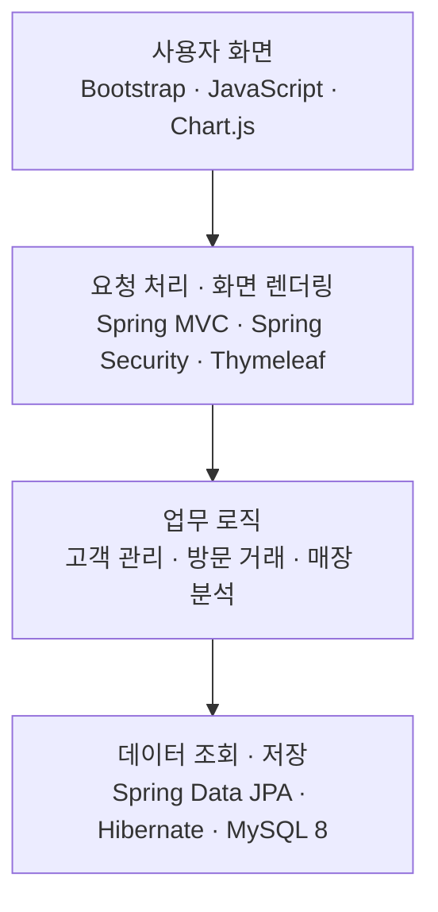

# StoreCRM | 다중 매장 고객 관리 시스템

StoreCRM은 소규모 매장 사장님이 고객 정보, 방문·결제 이력, 포인트, 쿠폰을 한곳에서 관리할 수 있는 CRM 웹 애플리케이션입니다. 한 사장님이 여러 매장을 운영할 수 있으며, 선택한 매장의 고객과 거래 데이터를 조회하고 관리할 수 있습니다.

매장 분석 화면에서는 매출과 방문 패턴을 확인하고, RFM으로 분류한 고객 등급에 맞춰 AI 재방문 문구를 생성할 수 있습니다. 플랫폼 관리자는 별도의 관리자 화면에서 사장님 계정과 매장 연결 현황을 관리합니다.

## 기술 스택

| 구분 | 사용 기술 |
| --- | --- |
| 언어·빌드 | Java 25, Gradle Wrapper 9.2.1, Lombok |
| 백엔드 | Spring Boot 4.0.0, Spring MVC, Bean Validation, 내장 Tomcat |
| 프론트엔드 | Thymeleaf, HTML·CSS·JavaScript, Bootstrap 5.3.3, Chart.js 4.4.1 |
| 데이터베이스 | MySQL 8, Spring Data JPA, Hibernate, JPQL·SQL |
| 인증·인가 | Spring Security, Google OAuth 2.0, JJWT 0.12.6, BCrypt |
| 외부 연동 | Spring RestClient, OpenRouter API, Spring Boot Mail, Gmail SMTP |
| 테스트 | JUnit 5, Mockito, Spring Boot Test, Spring Security Test, H2 |
| CI/CD·인프라 | GitHub Actions, AWS S3, AWS EC2, Ubuntu 24.04, systemd |

## 주요 기능

| 영역 | 구현 내용 |
| --- | --- |
| 인증·계정 | 회원가입, 세션 로그인·로그아웃, Google OAuth 2.0 로그인, JWT 로그인 API, 이메일 비밀번호 재설정, 본인 정보 수정 |
| 매장 관리 | 소유 매장 조회·선택·등록·수정, 다중 매장 관리, 매장 폐업 처리 |
| 홈 대시보드 | 선택 매장의 현재 고객 수, 오늘 방문 건수, 이번 달 매출 요약 |
| 고객 관리 | 매장별 고객 등록·조회·수정·삭제, 이름과 전화번호 뒤 4자리 검색, 페이지 조회, 전화번호 마스킹 |
| 방문·포인트·쿠폰 | 방문 및 결제 기록 등록, 거래에 따른 포인트 적립·사용, 쿠폰 발급·사용, 고객별 이력 조회 |
| 매장 분석 | 월간 매출·방문 건수·고유 방문 고객 수·재방문율, 최근 6개월 추이, 요일별·시간대별 방문 차트 |
| RFM 고객 분석 | 최근성·빈도·결제 금액 기반 고객 등급 산정, 등급 분포 차트, 고객 목록 정렬·페이지 이동 |
| AI 마케팅 | 매장 업종과 고객 등급에 맞춘 한국어 재방문 문구 3개 생성, 문구별 복사, 매장별 일일 생성 제한 |
| 플랫폼 관리자 | 사장님 계정과 매장 등록·수정, 매장 소유자 변경, 계정·매장 현황과 월별 신규 등록 집계 |

## 주요 구현

### 다중 매장과 역할별 접근 제어

- 사장님이 여러 매장을 소유할 수 있도록 회원과 매장의 관계를 구성했습니다.
- 고객 관리와 매장 분석 등 매장 단위 기능은 로그인한 회원의 매장 소유권을 서버에서 확인합니다.
- 사장님과 플랫폼 관리자의 업무 화면과 접근 범위를 구분했습니다. 사장님 역할은 코드에서 `USER`, 플랫폼 관리자는 `ADMIN`으로 표현합니다.

### 방문·포인트·쿠폰 거래

- 고객 상세 화면에서 방문과 결제 이력을 기록하고 포인트 및 쿠폰 이력을 확인할 수 있습니다.
- 방문 등록과 연계된 거래 처리는 트랜잭션으로 묶어, 처리 도중 오류가 나면 함께 롤백되도록 구성했습니다.
- 포인트 변경 시 고객 행에 비관적 쓰기 잠금(`PESSIMISTIC_WRITE`)을 적용해 동시 요청에서 잔액이 어긋나는 문제를 방지합니다.

### 고객 개인정보 처리와 과거 거래 보존

- 고객 삭제 시 삭제 시각을 기록하고 업무 조회에서 제외하는 소프트 삭제를 적용했습니다.
- 고객 삭제 후 3개월이 지나면 이름, 전화번호, 생일, 메모 등 주요 개인정보를 정리하는 예약 작업을 구성했습니다. 운영 환경에서는 설정으로 활성화합니다.
- 매장 폐업 시 해당 매장의 고객 주요 정보와 방문 메모 등을 즉시 정리합니다. 고객·매장 ID와 거래 관계는 유지해 과거 방문·매출을 집계할 수 있도록 했습니다.

### 매장 분석과 RFM 고객 등급

- 조회 매장과 월을 기준으로 월간 지표를 집계하고 최근 6개월 매출·방문 고객 추이와 요일별·시간대별 방문을 Chart.js로 시각화했습니다.
- 기간 내 재방문율은 선택 월의 고유 방문 고객 중 같은 달에 두 번 이상 방문한 고객의 비율로 계산합니다.
- RFM은 선택 월 말까지의 마지막 방문일(R), 최근 6개월 방문 횟수(F), 최근 6개월 결제 합계(M)를 사용합니다. MySQL의 `NTILE(5)`로 항목별 상대 점수를 산정한 뒤 VIP·단골·일반·이탈 위험으로 분류합니다.
- 선택 월 말 기준 60일 이상 미방문한 고객은 이탈 위험으로 우선 분류하고, 소프트 삭제된 고객은 RFM 집계에서 제외합니다.

### AI 재방문 마케팅 문구

- 분석 화면에서 고객 등급을 선택하면 Spring `RestClient`로 OpenRouter를 호출해 한국어 재방문 문구 3개를 생성합니다.
- 외부 요청에는 매장 업종, 고객 등급, 등급별 인원수, 문구 주제를 사용합니다. 고객 이름과 연락처는 전송하지 않습니다.
- 문구 수, 길이, 중복 여부, 응답 잘림을 검증하고, 형식 검증에 실패하면 한 번 더 요청합니다.
- 한국 시간 기준 매장당 하루 5회로 제한하며, 생성에 실패하면 예약한 횟수를 복구합니다. 화면에서는 문구별 복사와 남은 횟수 확인을 지원합니다.


## 시스템 흐름



화면 조회 시 서버는 처리 결과를 Thymeleaf로 렌더링해 브라우저에 반환합니다. 분석 화면에서는 Chart.js가 매출·방문 지표와 RFM 결과를 차트로 표시합니다.

### 외부 서비스 연동

| 사용자 동작 | 연결 기술 | 결과 |
| --- | --- | --- |
| AI 문구 생성 | Spring `RestClient` → OpenRouter API | 생성된 문구 3개를 받아 화면을 새로고침하지 않고 표시 |
| 비밀번호 재설정 요청 | Spring Boot Mail → Gmail SMTP | 가입한 이메일로 비밀번호 재설정 링크 발송 |

## 팀 구성

| 역할 | 이름 | 담당 |
| --- | --- | --- |
| 팀장 · B 파트 | 김순민 | 고객 관리, 플랫폼 관리자, 공통 UI·홈, 기능 통합 및 문서 |
| 부팀장 | 배수환 | 인프라, 보안, CI/CD 및 배포 |
| A 파트 | 황현우 | 인증, 회원, 사장님 계정 및 매장 관리 |
| C 파트 | 이재준 | 방문, 포인트, 쿠폰 |
| D 파트 | 한상희 | 매장 분석 대시보드, RFM 고객 등급, AI 재방문 문구 |

## 로컬 실행

### 1. 저장소와 실행 환경 준비

JDK 25와 MySQL 8을 설치하고 `crm` 데이터베이스와 접속 계정을 준비합니다.

```bash
git clone https://github.com/sm-k-dev/team1crm.git
cd team1crm
```

DB 생성과 기존 스키마 변경은 [SQL 스크립트](docs/sql)와 [환경 설정 가이드](docs/ENVIRONMENT_SETUP.md)를 참고하세요.

### 2. 환경변수 설정

[`.env.example`](.env.example)을 참고해 IDE 실행 설정이나 실행 프로세스에 환경변수를 지정합니다. Spring Boot는 이 프로젝트에서 `.env` 파일을 자동으로 읽지 않습니다.

| 환경변수 | 용도 |
| --- | --- |
| `SPRING_PROFILES_ACTIVE` | 로컬 개발 `dev`, 운영 `prod` |
| `SERVER_PORT` | 서버 포트. 로컬 예시 `8082` |
| `DB_URL` | MySQL JDBC 주소. 예시 `jdbc:mysql://localhost:3306/crm?serverTimezone=Asia/Seoul&characterEncoding=UTF-8` |
| `DB_USERNAME`, `DB_PASSWORD` | MySQL 접속 계정과 비밀번호 |
| `JWT_SECRET` | JWT 서명 키. 최소 32바이트 |
| `GOOGLE_CLIENT_ID`, `GOOGLE_CLIENT_SECRET` | Google OAuth 2.0 클라이언트 설정 |
| `MAIL_USERNAME`, `MAIL_APP_PASSWORD` | 비밀번호 재설정 메일을 보낼 Gmail 계정과 앱 비밀번호 |
| `APP_BASE_URL` | 비밀번호 재설정 링크에 사용할 서비스 주소 |
| `OPENROUTER_API_KEY`, `OPENROUTER_MODEL` | 실제 AI 문구 생성에 사용할 API 키와 모델 |
| `CUSTOMER_PRIVACY_ENABLED`, `CUSTOMER_PRIVACY_CRON` | 고객 개인정보 정리 배치의 활성화 여부와 실행 시각 |

Google 로그인 로컬 콜백 URI는 `http://localhost:8082/login/oauth2/code/google`입니다. Google Cloud에 등록한 URI는 실제 포트와 일치해야 합니다.

### 3. 애플리케이션 실행

**Windows PowerShell**

```powershell
.\gradlew.bat bootRun
```

**macOS / Linux**

```bash
./gradlew bootRun
```

기본 로컬 주소는 `http://localhost:8082`입니다. 개발 프로필에서는 `CRM_DEMO_ENABLED=true`와 비밀번호 정책을 충족하는 `CRM_DEMO_PASSWORD`를 설정해 시연용 계정과 방문 데이터를 생성할 수 있습니다.

## 테스트와 배포

**Windows PowerShell**

```powershell
.\gradlew.bat test
.\gradlew.bat bootJar
```

**macOS / Linux**

```bash
./gradlew test
./gradlew bootJar
```

- 테스트 보고서는 `build/reports/tests/test/index.html`에서 확인합니다.
- 실행 파일은 `build/libs/crm.jar`이며, 환경변수를 설정한 뒤 `java -jar build/libs/crm.jar`로 실행합니다.
- [CI 워크플로](.github/workflows/ci.yml)는 PR과 `main`·`develop` 브랜치 푸시에서 빌드 및 테스트를 수행합니다.
- [CD 워크플로](.github/workflows/cd.yml)는 `main` 브랜치의 빌드 결과를 AWS S3에 전달하고, EC2의 `crm` 서비스를 systemd로 재시작합니다.
- 개발 프로필의 JPA 스키마 설정은 `update`, 운영 프로필은 `validate`입니다. 운영 DB에는 필요한 스키마 변경을 배포 전에 적용합니다.

### 운영 검증 범위

자동 테스트는 입력 검증, 매장 접근 제어, 고객 삭제 및 이력 보존, RFM 집계, AI 응답 검증과 사용량 제한 등을 다룹니다. 실제 MySQL에서의 동시 거래, 브라우저 화면, Gmail SMTP 수신, EC2 배포 후 동작은 별도 환경에서 확인합니다.

## 프로젝트 구조

```text
src/
├── main/
│   ├── java/com/team1/crm/
│   │   ├── auth/          인증, 회원, 매장, 본인 정보
│   │   ├── admin/         플랫폼 관리자 기능
│   │   ├── home/          매장 홈 요약
│   │   ├── customer/      고객 관리와 개인정보 처리
│   │   ├── loyalty/       방문, 포인트, 쿠폰
│   │   ├── analytics/     매장 분석, RFM, AI 마케팅
│   │   └── common/        공통 설정과 DTO
│   └── resources/
│       ├── templates/     Thymeleaf 업무 화면
│       └── static/        CSS, JavaScript, 정적 화면
└── test/                  자동 테스트

docs/                      설계, 정책, 테스트 기록, SQL
deploy/                    서비스 설정과 배포 스크립트
.github/workflows/         CI/CD 워크플로
```

